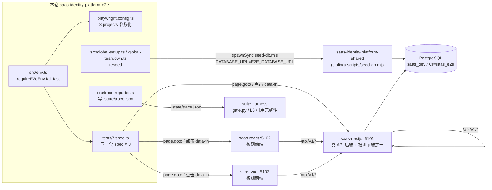
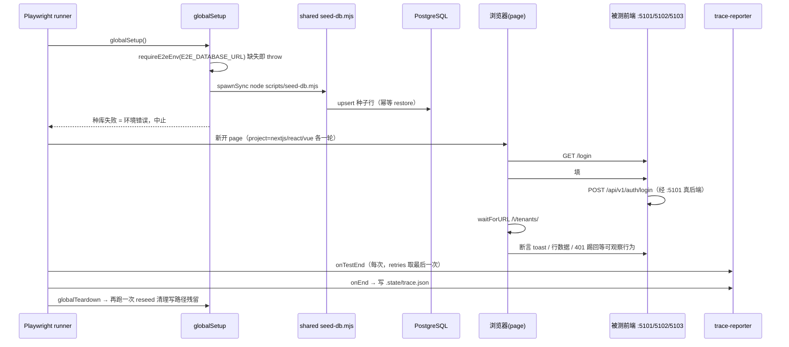

# saas-identity-platform-e2e 架构

> 一句话定位：家族 6 角色中的 e2e 仓——用同一套 Playwright spec × 三个 project（nextjs/react/vue）驱动真实前端 + 真实后端（saas-nextjs :5101）跑用户旅程，验证三端交互一致性（ADR-0030）。

生成日期：2026-09-22 ｜ 锚定 HEAD：439bc7f ｜ 生成方式：DeepWiki 风格架构扫描

## 1. 总览

- **定位与职责**：e2e 一致性验证层。不实现业务，只消费家族实现仓；核心铁律是「**用例禁止分叉**」——同一份 spec 指三端地址，spec 内出现 per-端 分支即 parity 失效（CLAUDE.md §2）。
- **技术栈**：`@playwright/test ^1.63.0` + TypeScript ^7.0.2（`package.json`）；stack 声明为 `generic`（`.harness/stack.json`）。功能清单使用保留命名空间 `M95`（不镜像 BASE 业务模块，覆盖的业务子项以 BASE ID 写在用例标题里，`docs/functions/function-tree.md`）。
- **规模速览**：`src/` 4 个文件 140 行；`tests/` 11 个文件（9 个 spec + helpers）652 行，合计 792 行；约 30 个 test 用例 × 3 project = 每轮最多约 90 次浏览器执行；docs 含 6 份 REQ + function-tree + 2 份 design-map + e2e-runtime 约定。

## 2. 系统架构

关键边界：① 本仓**不自起任何被测进程**（ADR-0030 Decision 7），四个服务全由外部起好（`docs/conventions/e2e-runtime.md` §2），连接被拒是环境错误不是用例失败；② msw 仓已于 2026-09-17 删除，API 后端是真 saas-nextjs :5101；③ 与 shared 的唯一运行时耦合是 seed-db.mjs（靠 `__dirname` 找 sibling）；④ 对 suite 的唯一产出契约是 `.state/trace.json`（与 `.harness/stack.json` 并称两份契约）。

## 3. 模块分解

| 模块/目录 | 职责 | 关键文件 |
|---|---|---|
| 运行时环境 | env 加载（.env.local → .env，不覆盖已有值）+ `requireE2eEnv` fail-fast 读取 | `src/env.ts` |
| 生命周期钩子 | 跑前/跑后调用 shared seed-db upsert 还原种子，根除跨运行累积 flaky | `src/global-setup.ts`、`src/global-teardown.ts` |
| trace 映射器 | Playwright Reporter：标题正则收 fn ID、只落本仓 `M95.*` 命名空间（BASE ID 留在标题文本）、inert 用例 fns 清空、retries 去重，onEnd 一次性写 `.state/trace.json` | `src/trace-reporter.ts` |
| 参数化配置 | 三个 project（nextjs/react/vue）共用同一 testDir，baseURL 各自从 env 读；retries=1 缓解浏览器 flaky | `playwright.config.ts` |
| 契约自检 spec | 锚仓内基建文件而非 DOM：config 三 project、CI 编排（tag/nightly + sibling checkout）、后端端口接线 5101-5103 | `tests/env-contract.spec.ts`、`tests/infra-contract.spec.ts` |
| 用户旅程 spec | 登录 / OAuth 跳板 / 租户 CRUD / 角色 CRUD / 菜单授权 / 会话（登出+切租户）/ 全路由冒烟 / UI parity | `tests/login.spec.ts`、`tests/oauth-jump.spec.ts`、`tests/tenant-crud.spec.ts`、`tests/role-crud.spec.ts`、`tests/role-menu-grant.spec.ts`、`tests/session.spec.ts`、`tests/smoke-nav.spec.ts`、`tests/ui-parity.spec.ts` |
| 公共助手 | `loginViaUi`（UI 密码登录落 /tenants）、`uniqueCode`（随机业务 code 防唯一约束撞车） | `tests/helpers.ts` |
| 功能锚点文档 | 需求 → 设计 → 功能树三账本；M95 命名空间声明 | `docs/requirements/`、`docs/design/`、`docs/functions/function-tree.md` |
| CI 编排 | tag `v*` + nightly + 手动触发；起 PG service、checkout 4 个 sibling、起 3 被测进程、上传产物 | `.github/workflows/ci.yml` |

## 4. 数据流 / 请求生命周期

以一次带种子还原的「登录主旅程」为例（`tests/login.spec.ts` + `tests/helpers.ts`）：

选择器纪律：只锚 `data-fn` 属性与用户可观察行为（loading/empty/error/toast/禁用），禁止锚 DOM 结构、组件库类名、CSS——这是三端 parity 能成立的前提。

## 5. 依赖面

- **对 shared 契约仓**（`../saas-identity-platform-shared`）：仅消费 `scripts/seed-db.mjs`（migrate/seed 权威源）。依赖方式是 sibling 目录 + `__dirname` 相对定位（Playwright 把 globalSetup 转译成 CJS，`import.meta` 不可用）；CI 由 ci.yml 统一 checkout。
- **对家族实现仓**：依赖三个 dev server 进程在位——nextjs:5101（同时是 API 后端）、react:5102、vue:5103；三前端的 API base 必须指向 :5101（react/vue `VITE_API_BASE_URL`，nextjs `NEXT_PUBLIC_*_API_BASE_URL`）；saas-nextjs `SAAS_CORS_ALLOWED_ORIGINS` 白名单须含三端口。
- **无 shared 生成物消费**：本仓不 import codegen SDK，API 断言只通过浏览器网络层（`waitForRequest` / 页面行为）间接观察。
- **外部依赖**：PostgreSQL（`E2E_DATABASE_URL` 指向被测 nextjs 实际连的同一库；CI=saas_e2e scratch，本机=saas_dev）；无 IdP 外部服务——OAuth 跳板用例（`oauth-jump.spec.ts`）走的是家族内 authorize 链路。

## 6. 配置与部署

env 变量表（`src/env.ts` 统一 fail-fast，**全部无默认值兜底**，缺失即 throw；样例进仓 `.env.example`，真值 `.env.local` gitignore）：

| key | 用途 | 缺失时的行为 |
|---|---|---|
| `E2E_NEXTJS_URL` / `E2E_REACT_URL` / `E2E_VUE_URL` | 三 project baseURL（`http://localhost:5101/5102/5103`） | config 加载即 throw |
| `E2E_DATABASE_URL` | globalSetup/teardown 种子 upsert 目标库（必须=被测 nextjs 所连库） | globalSetup throw |
| `E2E_TEST_USERNAME` / `E2E_TEST_PASSWORD` | 登录凭据（saas seeds 用户 + 家族 DEMO_PASSWORD） | spec 模块加载即 throw |
| `E2E_TEST_CLIENT_ID` | 登录请求体 clientId 断言值（`saas-console` 自身应用） | spec 模块加载即 throw |

- **端口**：被测三端 5101/5102/5103（家族端口分段约定）；本仓自身无服务端口。
- **构建产物**：无独立构建；`npx tsc --noEmit`（L3）只做类型检查。运行时产物是 `.state/trace.json`。
- **部署方式**：无 Dockerfile / deploy 脚本（本仓是测试仓不部署）。CI 触发面为 tag `v*` + nightly schedule + workflow_dispatch，不进每 commit（ADR-0030 Decision 7）；工作流 timeout 40 分钟，起 PG service 容器。
- **数据生命周期**：跑前 reseed 还原种子、跑后再 reseed 清理写路径残留（`global-setup.ts`/`global-teardown.ts` 成对）；业务自产行靠 `uniqueCode` 随机 code，不做删除式清理。

## 7. 质量门禁

来自 `.harness/stack.json`：

| 门 | 名称 | 命令 |
|---|---|---|
| L3 | 类型 | `npx --no tsc --noEmit` |
| L4 | E2E 三端一致性 | `npx --no playwright test`（trace_cmd 同款） |

L4 前置：三个被测进程在跑 + shared migrate+seed 灌好的 PG 库；没起服 connection refused 是环境错误不是用例失败。验收在 **suite 根目录**跑 `python scripts/gate.py -p saas-identity-platform-e2e`——exit code 是唯一真相：**0 = 完成；1 = 按修复提示回代码；2 = 契约/环境问题，停下问人**。

trace 语义补充（suite 契约二）：`.state/trace.json` 由 `trace-reporter.ts` 产出、只收 `M95.*` 本仓命名空间 fns；inert（skipped/interrupted）用例 fns 必为空数组——声称覆盖却不执行会被 L5 引用完整性判定为假绿。禁止给 skip/xfail 的测试挂功能 ID（suite CLAUDE.md §2）。
