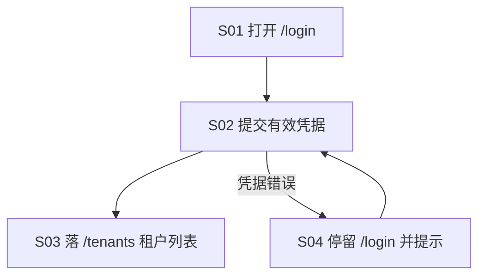

# 流程与功能对齐 — SaaS身份平台前端E2E一致性

> 人填、人评审。机器只检查引用的功能 ID 是否存在。
> 评审时把流程图投出来，逐行念「这一步靠哪些功能完成」。念不出来的行，
> 要么流程是空的，要么功能是缺的。这就是对齐的全部意义。

## FLOW-01 三端密码登录主流程

> 本仓唯一入流程的功能是登录用例（M95.F02.I01）：它是所有后续验收线的公共前置 ——
> 不登录进不了任何页面。错误凭据的退回路径并入本流程 S04，不另设 FLOW-02。
> 其余子项（各业务用例、基建件）自成闭环或属运行容器，见下方孤儿清单。

| 步骤 | 名称 | 角色 | 输入 | 输出 | 状态流转 | 支撑功能子项 |
|---|---|---|---|---|---|---|
| S01 | 打开登录页：表单渲染，提交按钮挂密码登录 `data-fn` 锚点 | 访客 | 三端 baseURL（env fail-fast） | 登录表单可见 | — | M95.F02.I01 |
| S02 | 提交有效凭据（fixture 用户 + 家族 DEMO_PASSWORD，clientId=saas-console） | 测试用户 | 表单值 | 请求体携带 clientId，会话建立 | 未登录 → 已登录 | M95.F02.I01 |
| S03 | 落 `/tenants`：租户列表首屏 | 已登录 | 会话 | 列表页渲染 | — | M95.F02.I01 |
| S04（退回） | 错误凭据停留：不跳转，展示错误提示 | 访客 | 错误密码 | 错误提示可见 | 已登录 → 未登录 | M95.F02.I01 |

### 评审时问这四个问题

1. 有没有哪个步骤的「支撑功能子项」是空的？→ 功能缺失，或这一步不该存在
2. 有没有功能子项从头到尾没出现在任何流程里？→ 见下方孤儿清单
3. 状态流转列里的状态名，和代码里的枚举一致吗？→ 不一致就是两套真相
4. 退回路径都画了吗？→ 只画正向流程，会漏掉一半功能

### 孤儿功能

不在任何流程里但合法的功能。**没解释的孤儿 = 没人要的功能。**
本仓是 E2E 验证层：每条业务用例是独立验收线（登录后各自起闭环），
基建件是运行容器/产物加工 —— 它们不是「用户流程的步骤」，全部合法孤儿。

| 功能 ID | 为什么合法 |
|---|---|
| M95.F01.I01 | 三端参数化是运行容器（playwright project 配置），所有用例隐式经它执行，本身不是流程步骤 |
| M95.F01.I02 | CI 编排只在 tag/nightly 触发，属于调度层，不在任何被验流程内 |
| M95.F02.I02 | 租户 CRUD 用例登录后自成闭环（自产自销 uniqueCode），不依赖其他用例 |
| M95.F02.I03 | 会话用例（登出/切租户）自成闭环，与主流程共享的只有登录前置 |
| M95.F02.I04 | 角色 CRUD 用例自成闭环 |
| M95.F02.I05 | 角色菜单授权用例自成闭环（seed grant 回读 + PUT 自还原） |
| M95.F02.I06 | OAuth 跳板全链自成闭环（authorize 往返 + 拒绝路径都在用例内走完） |
| M95.F03.I01 | trace 映射是跑测结束后的产物加工（onEnd 落盘），在流程之外 |
| M95.F04.I01 | msw 接线是起服前置约定（外部起服，本仓不自起），不是流程步骤 |

---

## FLOW-02 异常流程

错误凭据退回路径已并入 FLOW-01 S04。本仓暂无独立异常流程；
后续若铺开「会话过期」「后端不可达」类用例，在此单独成表。
